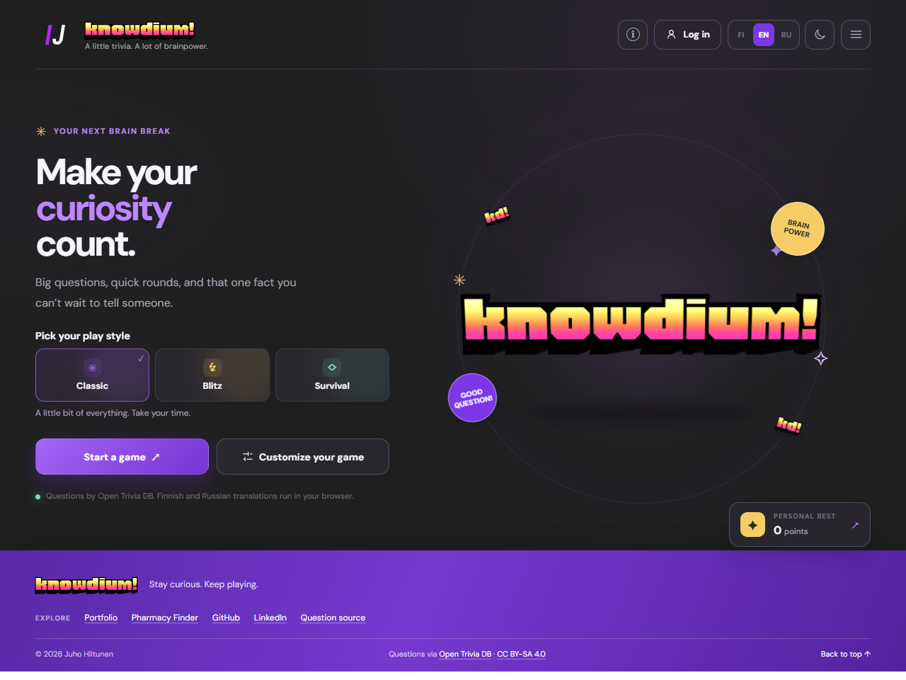

# knowdium!

A multilingual trivia game built with React and the [Open Trivia Database](https://opentdb.com/).

**[Play the live demo](https://hiltunenjuho.github.io/knowdium/)**



Choose Classic, Blitz, or Survival and customize the question count, category, difficulty, and question type. Scores and the personal best are tracked during play; the personal best is saved in browser storage.

Classic has no time limit by default; an optional per-question limit can be selected in settings for the next game. Blitz and Survival keep their 12- and 15-second limits. Correct answers earn difficulty and streak points, with an additional speed bonus only when a timer is active.

Survival divides the selected question count into easy, medium, and hard stages, in that order. Its difficulty is automatic; category and answer-type filters still apply. The three question requests are spaced to respect Open Trivia DB's rate limit, so starting a Survival game takes at least 10 seconds. If a stage has too few questions for the selected filters, choose fewer questions or change the filters.

The interface defaults to the browser's Finnish, English, or Russian language; other languages default to English. The theme follows the device preference until manually changed. Language and theme selections are saved in browser storage.

## Questions and translations

Questions come from Open Trivia DB and are licensed under [CC BY-SA 4.0](https://creativecommons.org/licenses/by-sa/4.0/). Open Trivia DB has its own request limits and requires a network connection.

The category selector uses built-in Finnish and Russian translations for the current Open Trivia DB categories. Newly added categories fall back to their original English names until translations are added.

The original questions are in English. When Finnish or Russian is selected, questions, categories, and answers are translated on the device in a Web Worker using [Transformers.js](https://huggingface.co/docs/transformers.js) and quantized [English–Finnish](https://huggingface.co/Xenova/opus-mt-en-fi) or [English–Russian](https://huggingface.co/Xenova/opus-mt-en-ru) models, based on Helsinki-NLP's OPUS-MT models. There is no per-translation API quota.

The first use downloads about 115 MB per language from Hugging Face; subsequent use can reuse the browser's model cache, subject to browser storage policies. Download availability, network access, device memory and processing speed can still limit use. Machine translations can be inaccurate, especially for names and trivia-specific terms; the original question can be opened beneath its translation. Quoted text and SQL answer keywords are preserved where possible. The next question is translated in the background when possible, and the timer pauses if a translation is still loading.

## Run locally

Requires Node.js and npm:

```bash
npm ci
npm run dev
```

Create and preview a production build:

```bash
npm run build
npm run preview
```

Run the linter:

```bash
npm run lint
```

## Deployment

The GitHub Actions workflow builds the app with Node.js 22 and publishes `dist` to GitHub Pages on pushes to `main`. The Vite base path is `/knowdium/`.
